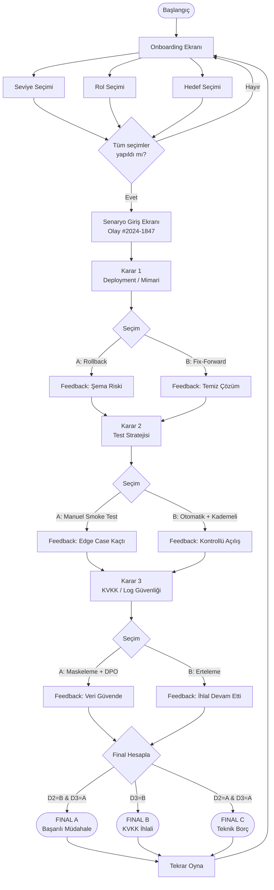

# SE Primer Specification

## Problem

Yazılım mühendisliği eğitiminde klasik öğretim yöntemleri (ders anlatımı, slayt sunumları, çoktan seçmeli sorular) öğrencilerin kavramları pasif olarak edinmesine yol açmaktadır. Öğrenciler "rollback nedir?" sorusuna doğru yanıt verebilirken, gerçek bir sistemde rollback kararının migration ile nasıl çakışabileceğini; ya da loglardaki kişisel verinin KVKK kapsamında nasıl bir ihlal oluşturabileceğini ancak olayı bizzat yaşayarak kavrayabilir.

**SE Primer**, yazılım mühendisliği öğrencilerinin kavramları yalnızca okuyarak değil, kararlarının somut teknik sonuçlarını deneyimleyerek öğrenmesini amaçlar. Uygulama; gerçekçi bir hastane sistemi krizi senaryosu üzerinden öğrencileri mühendislik kararı vermeye zorlar ve her kararın neden doğru ya da riskli olduğunu öğretir.

---

## Target User

- **Birincil kullanıcı**: Yazılım mühendisliği lisans/önlisans öğrencileri (YZM301 ve benzeri dersler)
- **İkincil kullanıcı**: Junior software engineer adayları, bootcamp katılımcıları
- **Bağlam**: Ders içi etkinlik, ödev ya da kişisel çalışma aracı olarak kullanılabilir

---

## Scope

Bu MVP kapsamında:

- ✅ **Mobil web uygulaması** (React + Vite, responsive tasarım)
- ✅ **3 onboarding sorusu** (Seviye, Rol, Hedef)
- ✅ **1 sağlık senaryosu** (HastaBakım HMS sistemi çöküşü)
- ✅ **3 karar noktası** (Deployment/mimari, Test stratejisi, KVKK/log güvenliği)
- ✅ **2+ farklı final** (FINAL_A: Başarılı, FINAL_B: KVKK ihlali, FINAL_C: Kısmi risk)
- ✅ **Karar sonrası açıklama** ("Ne Oldu?" ve "Neden Oldu?" panelleri)
- ✅ **AI Tutor** (Sokratik yöntem, Gemini API veya mock)
- ✅ **Kişiselleştirme** (Seviyeye göre ipuçları, deneyimliler için timer)
- ✅ **Cypress E2E testleri** (8 temel test)
- ✅ **Tutor evaluation dataset** (20 örnek)
- ✅ **Tamamen kurgusal veriler** (Gerçek hasta bilgisi yok)

---

## Out of Scope

Aşağıdaki özellikler bu MVP kapsamı dışındadır:

- ❌ **Kullanıcı hesabı / giriş sistemi** — Kimlik doğrulama, öğrenme hedefine katkı sağlamayacağından kapsama alınmadı.
- ❌ **İkinci senaryo veya yeni bölüm** — Ödev teslim kapsamı tek sağlık senaryosu ile sınırlıdır.
- ❌ **Gerçek hasta verisi** — Etik ve yasal nedenlerle tüm veriler tamamen kurgusaldır.
- ❌ **Native Android / iOS uygulaması** — Teslim gereksinimi mobil uyumlu web uygulamasıdır.
- ❌ **Çoklu dil desteği** — Uygulama yalnızca Türkçe olarak geliştirilmiştir.

---

## Acceptance Criteria

### AC-1 — Kişiselleştirilmiş Tutor İpucu

```
Given  kullanıcı "Yeni başladım" seviyesini seçmiştir
When   karar ekranına gelir ve AI Tutor'ı açar
Then   kullanıcı daha açıklayıcı, yönlendirici fakat cevabı vermeyen bir ipucu görmelidir
And    ipucu metni "A seçeneğini seç" veya "B doğru" gibi ifadeler içermemelidir
```

### AC-2 — Deneyimli Kullanıcı Timer

```
Given  kullanıcı "Deneyimliyim" seviyesini seçmiştir
When   karar ekranına gelir
Then   60 saniyelik bir geri sayım timer görüntülenmelidir
And    timer süresi dolduğunda kullanıcı yine de kararını verebilmelidir
And    uygulama tamamen kilitlenmemelidir
```

### AC-3 — Karar Sonrası Geri Bildirim

```
Given  kullanıcı herhangi bir karar ekranında bir seçim yapmıştır
When   seçim tamamlanır
Then   "Ne Oldu?" paneli seçimin sistem üzerindeki sonucunu göstermelidir
And    "Neden Oldu?" paneli sonucun yazılım mühendisliği açısından nedenini açıklamalıdır
And    "Sonraki Karar" butonu görünür olmalıdır
```

### AC-4 — Farklı Finaller

```
Given  kullanıcı Karar 3'te "B — Olayı Belgele, Çözümü Sonraya Bırak" seçmiştir
When   tüm kararlar tamamlanır
Then   KVKK ihlalini anlatan final ekranı (FINAL_B) görüntülenmelidir
And    FINAL_B metni güvenlik ihlali konusunu açıkça belirtmelidir

Given  kullanıcı Karar 3'te "A — Acil Maskeleme + Temizlik" seçmiştir
And    Karar 2'de "B — Otomatik Regresyon + Kademeli Açılış" seçmiştir
When   tüm kararlar tamamlanır
Then   başarılı final ekranı (FINAL_A) görüntülenmelidir
```

### AC-5 — Tekrar Oyna

```
Given  kullanıcı final ekranındadır
When   "Tekrar Oyna" butonuna tıklar
Then   uygulama başlangıç onboarding ekranına dönmelidir
And    önceki seçimler temizlenmiş olmalıdır
And    tüm 3 onboarding sorusu tekrar gösterilmelidir
```

### AC-6 — Onboarding Doğrulama

```
Given  kullanıcı onboarding ekranındadır
When   3 sorudan en az biri yanıtsız bırakılmıştır
Then   "Senaryoyu Başlat" butonu devre dışı (disabled) olmalıdır
And    kullanıcı senaryoya geçememeli dir
```

### AC-7 — KVKK Senaryosu

```
Given  kullanıcı Karar 3'teki KVKK / log güvenliği kararına ulaşmıştır
When   karar ekranını görüntüler
Then   log maskeleme ile verileri paylaşma arasında gerçekçi bir ikilem sunulmalıdır
And    feedback paneli KVKK kapsamında veri ihlalinin neden oluştuğunu veya önlendiğini açıklamalıdır
```

---

## User Flow



---

## Senaryo Dallanma Mantığı

| Karar 1 | Karar 2 | Karar 3 | Final |
|---------|---------|---------|-------|
| A (Rollback) | A (Manuel) | A (Maskeleme) | FINAL_C |
| A (Rollback) | A (Manuel) | B (Erteleme) | FINAL_B |
| A (Rollback) | B (Otomatik) | A (Maskeleme) | FINAL_A |
| A (Rollback) | B (Otomatik) | B (Erteleme) | FINAL_B |
| B (Fix-Forward) | A (Manuel) | A (Maskeleme) | FINAL_C |
| B (Fix-Forward) | A (Manuel) | B (Erteleme) | FINAL_B |
| B (Fix-Forward) | B (Otomatik) | A (Maskeleme) | **FINAL_A** |
| B (Fix-Forward) | B (Otomatik) | B (Erteleme) | FINAL_B |

> **Not**: Final hesaplama `computeOutcome()` fonksiyonu ile yapılır (`src/data/scenario.js`).
> Karar 3 (KVKK) sonucu en belirleyici faktördür.

---

## Teknik Notlar

- **State yönetimi**: React local state (localStorage entegrasyonu opsiyonel)
- **Tutor API**: `src/services/tutorService.js` — Gemini veya Mock
- **Environment variable**: `VITE_GEMINI_API_KEY` (`.env` dosyasında, kod içinde sabit yok)
- **Test**: Cypress E2E (`cypress/e2e/se_primer.cy.js`)
- **Veri**: `src/data/scenario.js` — tüm senaryo metinleri component dışında
